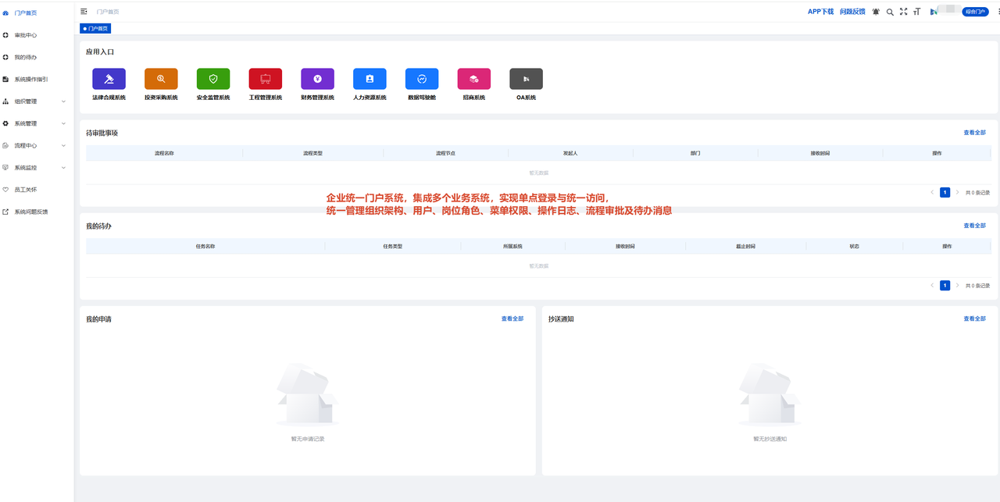
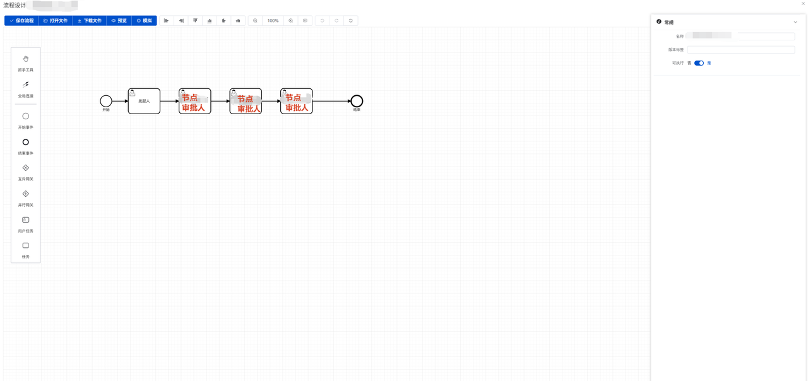
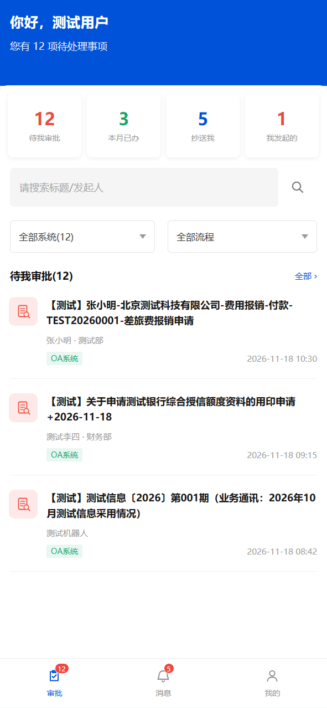
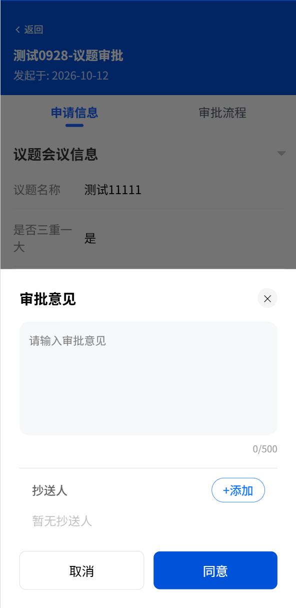
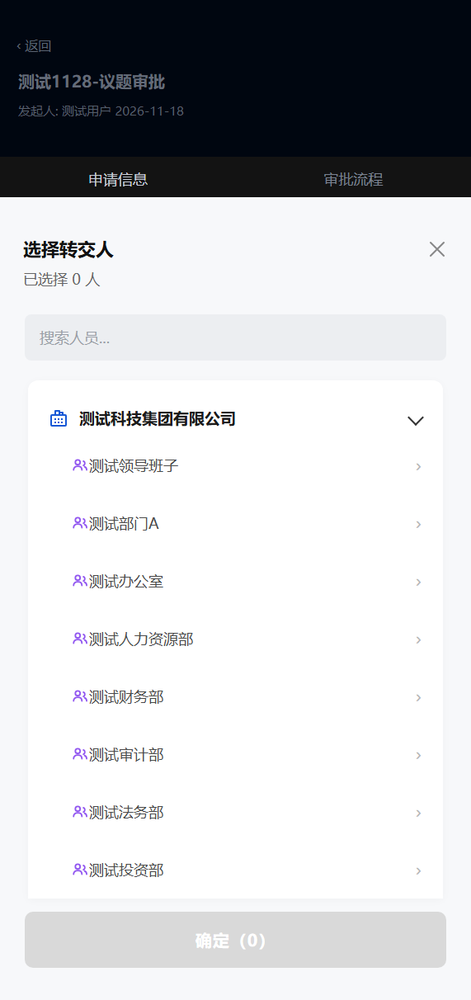
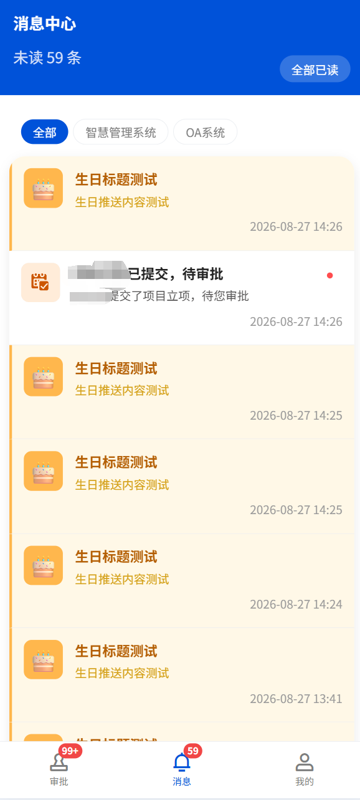

# Portfolio
Personal Portfolio showcasing my projects, technical skills, and full-stack development experience.

# 企业统一门户系统

## 项目介绍
集成多个业务系统，实现单点登录与统一访问，统一管理组织架构、用户、岗位角色、菜单权限、操作日志、流程审批及待办消息。

## 项目展示

### 1. 门户首页
展示各业务系统入口，提供统一的系统访问入口。

### 2. 流程设计
支持业务审批流程的设计与配置。

### 3. 移动端应用（Android / iOS）
支持移动端访问门户、处理待办及审批业务。

### 4. 审批处理
支持审批操作，包括同意、拒绝、抄送及转交。

### 5. 抄送人与转交人选择
支持选择抄送对象及任务转交人员。

### 6. 消息中心
集中展示待办任务、审批通知及相关业务消息。

